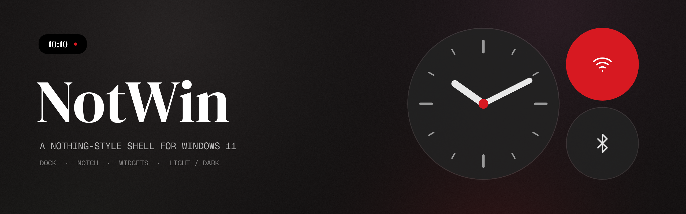
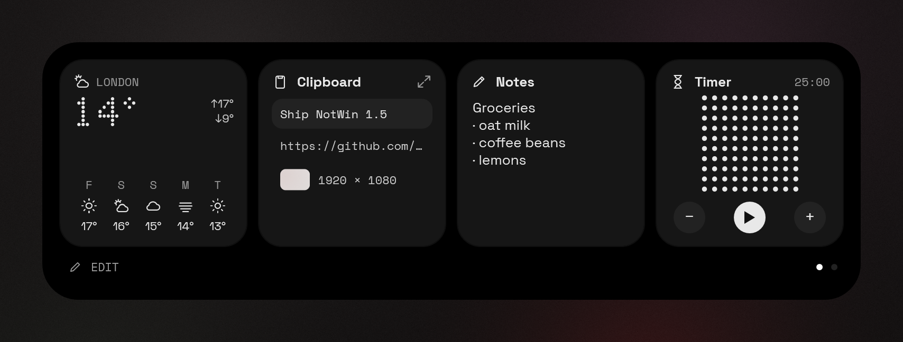
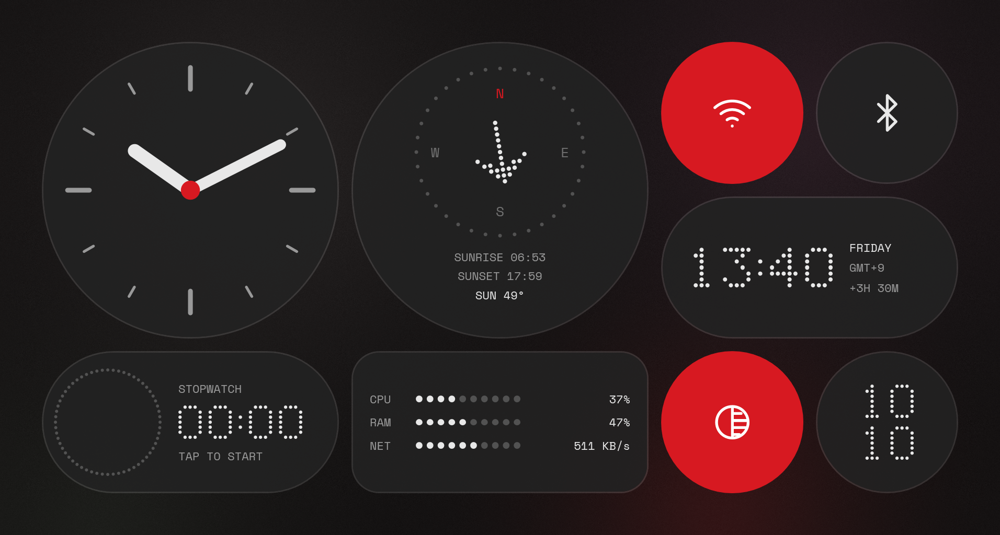
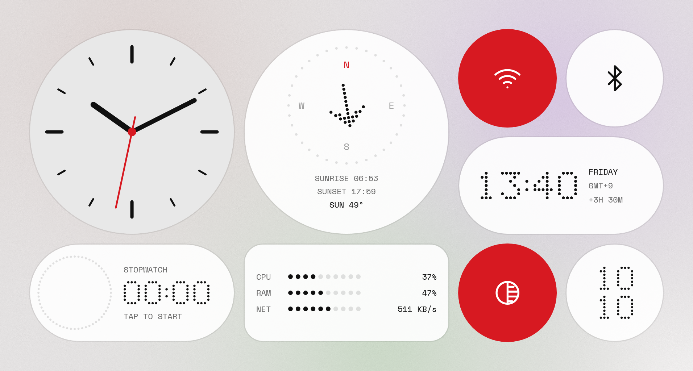

<p align="center">
  <a href="https://github.com/imsky1812/NotWin/releases/latest"></a>
</p>

<p align="center">
  <a href="https://github.com/imsky1812/NotWin/releases/latest"></a>
  <a href="https://github.com/imsky1812/NotWin/releases"></a>
  <a href="https://github.com/imsky1812/NotWin/commits/main"></a>
  
  
</p>

<p align="center"><b>Your Windows 11 desktop, the Nothing way.</b></p>

<p align="center">
  <a href="https://github.com/imsky1812/NotWin/releases/latest/download/NotWin-Setup.exe">Download</a> |
  <a href="https://github.com/imsky1812/NotWin/releases">Releases</a> |
  <a href="#add-your-google-calendar">Calendar guide</a> |
  <a href="#build-from-source">Build from source</a>
</p>

# NotWin: a Nothing-style shell for Windows 11

NotWin replaces the Windows taskbar and dresses up the desktop in the style of Nothing OS: dot-matrix numbers,
monochrome with one red accent, round tiles and soft frosted cards. You get a floating **dock**, a **launcher**,
**quick settings** with your notifications, a **notch** at the top of the screen that opens into a dashboard, and
**desktop widgets**, all in light or dark. Everything runs on your PC, and quitting NotWin always gives the
Windows taskbar back.



## Quickstart

**[⬇ Download NotWin-Setup.exe](https://github.com/imsky1812/NotWin/releases/latest/download/NotWin-Setup.exe)**
(about 115 MB). It needs Windows 11, 64-bit, and nothing else: .NET is built in.

1. Double-click **NotWin-Setup.exe**. SmartScreen may say *"Windows protected your PC"*, because the file isn't
   signed by a known publisher. Click **More info**, then **Run anyway**.
2. Click **Yes** on the admin prompt, then **OK** on *"Install NotWin?"*.
3. A few seconds later the dock replaces your taskbar and *"NotWin is installed and running"* appears. NotWin now
   starts with Windows.

Push the mouse to the bottom edge for the dock, tap **Win** for the launcher, rest the mouse on the notch for the
dashboard, and right-click any widget for **Edit widgets**. Settings is in the start button's right-click menu.

**Updating:** run a newer `NotWin-Setup.exe` the same way. Your widgets, notes and settings are kept.
**Uninstalling:** go to **Settings > Apps > Installed apps > NotWin > Uninstall**. Your taskbar comes back.

## Widgets

Every widget follows the theme. Toggles turn red when they're on. Round widgets sit in circles, the rest in
rounded cards that snap to a dot grid.

| | |
|---|---|
|  |  |
| **Dark**, on the Lucent wallpaper | **Light**, the same widgets |

The full list:

| Widget | What it shows |
|---|---|
| **Clock** · **Analogue clock** · **Stacked clock** | The time in dots, with hands (light or dark face), or hours over minutes |
| **World clock** | Another time zone, with its offset from yours |
| **Toggles** | Wi-Fi, Bluetooth, Dark mode, Keep awake, Mic access, Camera access: one tap each |
| **Stopwatch** · **Timer** · **Alarm** | A dot ring that fills; a dot grid that goes out (the same timer as the notch); alarms with snooze |
| **Weather** · **Sun compass** | Now and the next days; sunrise, sunset and where the sun is |
| **Calendar** · **Up next** | Your month with event dots, and your coming meetings and trips (Google Calendar, read-only) |
| **Screen time** · **System meters** | How long the PC was in use today and this week; CPU, memory and network as dot bars |
| **Media** · **Battery** | The playing song with seekable dots; the laptop and Bluetooth devices |
| **Photo frame** · **App folder** · **Notes** | A slideshow (square or circle); a peek at a folder's apps; the notch's note |
| **Snake** · **Tic-tac-toe** | Snake speeds up as it grows and keeps your best score; tic-tac-toe against Nothing |

## What's in it

| Part | What it does |
|---|---|
| **Dock** | Start and search, pinned and running apps, tray (Wi-Fi, volume, battery, clock). Hides until the mouse touches the bottom edge, or stays up. Rest on an app for live window previews. |
| **Launcher** | Tap **Win**. Search apps, settings and files on this PC (no web), **Most used**, **All apps**, power. |
| **Quick settings** | **Win+A** or **Win+N**. Wi-Fi, Bluetooth, volume and output device, brightness, and notifications grouped by app. |
| **Notch** | A black pill at the top: the time in a serif font, battery, the playing song, new notifications, a running timer, charging. |
| **Notch dashboard** | Rest the mouse on the notch. Two pages of tiles: Timer, Media, Clipboard, Notes, Shelf, Keep awake, Weather, and tools (Grab text, Color, Snip, Phone, Draw, Settings). **Edit** resizes, removes and adds tiles. |
| **Desktop widgets** | Under your windows, still there after Win+D. Drag, resize and add them in edit mode. |
| **Theme** | **Settings › Theme** or the Dark mode toggle switch Windows' own light / dark mode, and the dock, notch, popups, Settings and every widget follow it. |
| **Lucent wallpaper** | Blurred light and dark wallpapers that take their colours from your photo frame and change with its slideshow. |
| **Sync** | Point Settings › Sync at a folder (OneDrive, say) to share settings, pins, widget layout, notes and alarms between PCs. |

## How it works

### The dock sits above every window

To float above other windows, elevated ones included, the dock needs Windows' `uiAccess`. Windows only grants
that to a signed program in Program Files. So setup makes a certificate just for your PC and signs NotWin with it.
The certificate's private key only ever lives in setup's memory, so once setup closes nothing else can be signed
with it. Setup then installs into `C:\Program Files\NotWin` and starts NotWin as you, not as admin.

### The taskbar always comes back

A small watchdog runs next to NotWin. If NotWin quits, crashes or is killed, the watchdog restores the taskbar and
its auto-hide setting. A Release build won't hide the taskbar at all unless the watchdog is running.

### Light, dark and Lucent

One theme switch drives everything: the dock, notch, notch tiles, quick settings, launcher, previews, popups,
Settings and every widget. The Lucent wallpaper is drawn on your PC from the colours of your photo frame's current
photo, so the desktop shifts with the slideshow, and every wallpaper change cross-fades.

### Quick, never slow

Popups arrive with a short fade-and-scale (170 ms) and leave faster (110 ms). Notch tiles fade in one after another
and lift slightly under the mouse. The notch reuses its tiles instead of rebuilding them each time it opens. Turn
off animation effects in Windows (Settings › Accessibility › Visual effects) and everything is instant.

### Private by design

Nothing leaves your PC except the weather (your city, to Open-Meteo) and, if you connect it, Google Calendar
(read-only, through a sign-in you own). NotWin's log never records note or clipboard text, song titles,
notification text, network or device names, or window titles.

## Keys and gestures

| Do this | To |
|---|---|
| Mouse to the bottom edge | Show the dock |
| **Win** | Open the launcher (type to search, ↑ ↓, **Enter**, **Esc**) |
| **Win+A** · **Win+N** · click the tray | Open quick settings and notifications |
| Rest on the notch | Open the dashboard. The mouse wheel or the dots switch pages, **Esc** closes it |
| Rest on a dock app | See live previews of its windows. Red ✕ closes one |
| Right-click a widget | **Edit widgets**: drag, change size, ✕ to remove, **＋ Add** for more |
| Right-click the start button | **Settings…**, keep the dock visible, start with Windows, quit |

## Add your Google Calendar

NotWin reads your calendar (read-only) through a Google sign-in that **you** own, so no one else's app ever sees
your events. You set it up once, in about five minutes.

<details>
<summary><b>Step by step</b></summary>

1. Open [Google Cloud Console](https://console.cloud.google.com/) and sign in with the Google account whose calendar
   you want. Create a project (top bar > project picker > **New project**, any name, e.g. `NotWin`).
2. Go to **APIs & Services > Library**, search **Google Calendar API**, and click **Enable**.
3. Go to **Google Auth Platform > Branding** (older consoles: **OAuth consent screen**). Fill in an app name (e.g.
   `NotWin`) and your email.
4. Go to **Audience**, choose **External**, then click **Publish app**. While the app is still in *Testing*, Google
   signs you out every 7 days and only listed test users can sign in.
5. Go to **Google Auth Platform > Clients** (older consoles: **Credentials**) and click **Create client**. Choose
   **Desktop app** and click **Create**. Copy the **Client ID** and **Client secret**.
6. In NotWin, open **Settings > Google Calendar**, paste the client ID and secret, and click **Connect**.
7. Your browser opens Google's sign-in. Pick your account. On *"Google hasn't verified this app"*, click
   **Advanced > Go to NotWin (unsafe)**: it is your own app. Allow read-only calendar access. When the page says you
   can close the tab, Settings shows **CONNECTED**.
8. Add the **Calendar** widget (edit widgets > **＋ Add > Calendar**) for dots under days with events, or **Up next**
   for your coming meetings and trips. The calendars switched on in Google Calendar are the ones shown.

Keep the client secret to yourself: paste it only into NotWin's Settings. It is stored encrypted for your Windows
account, never in a shared or synced file. **Disconnect** in the same place signs NotWin out.

| What you see | What to do |
|---|---|
| *Error 403: access_denied* | The app is still in *Testing* and your account is not a test user. Publish it (step 4) or add yourself under **Audience > Test users**. |
| Signed out after a week | Same cause: publish the app (step 4), then **Connect** again. |
| **OFFLINE** in Settings | No internet. The last events stay visible, and NotWin refreshes on its own every 15 minutes. |

</details>

## Build from source

You need the .NET 10 SDK and PowerShell 7 (`pwsh`). Building never runs as admin; only the copy into Program Files
does.

```powershell
dotnet build NotWin.sln
dotnet test NotWin.sln
```

```powershell
# install your build: first from a normal PowerShell 7 (NOT as administrator)
.\build\build.ps1
```

```powershell
# then from an elevated PowerShell 7 (Run as administrator)
.\build\install.ps1
```

```powershell
# or make the one-file installer, out\NotWin-Setup.exe (normal PowerShell 7)
.\build\make-setup.ps1
```

`build.ps1` makes a non-exportable code-signing certificate (`CN=NotWin Dev`) the first time, publishes NotWin, the
watchdog and the drag helper into `out\app`, and signs them. `install.ps1` trusts that certificate, refuses to go on
unless every file is validly signed by it, copies the files to `C:\Program Files\NotWin`, registers a small package
(Windows needs it before an app can read notifications) and starts NotWin as you. `uninstall.ps1` (elevated) undoes
it and gives the taskbar back.

`dotnet run --project src\NotWin` runs a Debug build without `uiAccess`. Quit the installed copy first: only one
copy runs at a time.

## Architecture

```
  NotWin.exe (WPF, runs as you, uiAccess)
     │
     ├── Dock ─────────── appbar at the bottom · tray · window previews
     ├── Launcher ─────── app / settings / file search
     ├── Quick settings ─ radios · audio · brightness · notifications (needs the package identity)
     ├── Notch ────────── pill states · dashboard tiles
     ├── Desktop widgets ─ cards on the desktop, under your windows
     └── Theme ────────── light / dark · Lucent wallpaper from the photo frame · motion
     │
  NotWin.Watchdog.exe ─── restores the taskbar if the shell is gone
  NotWin.DragHelper.exe ─ drags shelf files out to other apps
```

```
src/NotWin/           the WPF app: Dock, Launcher, Panel, Notch, Widgets, Settings, Theme
src/NotWin.Core/      pure logic (layouts, rules, sun maths, meters, sync, settings); unit-tested
src/NotWin.Native/    Win32 interop (CsWin32): taskbar, appbar, hooks, icons, wallpaper
src/NotWin.Watchdog/  restores the taskbar if the shell dies
src/NotWin.DragHelper/ drag-out for the shelf
src/NotWin.Setup/     the one-file installer: signs NotWin on each PC, installs, uninstalls
tests/                NotWin.Core.Tests and NotWin.Tests (xUnit), about 970 tests
build/                build.ps1 · install.ps1 · uninstall.ps1 · make-setup.ps1
wallpapers/           the Lucent light and dark wallpapers
docs/superpowers/     specs and plans for each part
```

## Your data: `%AppData%\NotWin`

| File | What it is |
|---|---|
| `settings.json` | Pins, notch dashboard layout, widget layout, weather city, timer length |
| `notes.txt` · `alarms.json` | The note shared by the notch and the Notes widget; your alarms |
| `clipboard.json` · `clips\` | The last 50 copies, up to 20 of them images (copies password managers mark private are skipped) |
| `frames\` | Copies of your photo frame photos |
| `shelf.json` | The files on the shelf (paths, not copies) |
| `screentime.json` | Minutes the PC was in use per day, for the Screen time widget |
| `weather.json` · `calendar.dat` | The last weather report; your calendar events, encrypted for your Windows account |
| `launcher-usage.json` | What you open from the launcher, for **Most used** |
| `log.txt` | Startup and shell events, never personal content |

Uninstalling leaves this folder in place. Delete it too if you want nothing left. If the taskbar is ever left
hidden, run:

```powershell
& 'C:\Program Files\NotWin\NotWin.Watchdog.exe' --restore-now --state "$env:APPDATA\NotWin"
```

## FAQ

**Does it change my Windows settings?** Only when you ask it to, with a toggle or the theme switch. NotWin never
changes your notification, Wi-Fi, volume or power settings on its own. It hides the taskbar while it runs and gives
it back when it quits.

**Why does SmartScreen warn me?** The installer isn't signed by a known publisher. Setup signs NotWin with a
certificate made only for your PC; see [The dock sits above every window](#the-dock-sits-above-every-window).

**Does it work on Windows 10?** No, only Windows 11, 64-bit.

**Can I keep my settings on two PCs?** Yes: **Settings › Sync** with a shared folder such as OneDrive. The Google
sign-in, photo-frame photos and start-with-Windows stay on each PC.

**How do I go back to the normal taskbar?** Right-click the start button and choose **Quit NotWin**, or uninstall
it. The taskbar always comes back.

## Status and license

NotWin is a personal project, built with care for one desktop and shared as-is. There is no open-source license yet,
so the code is not licensed for reuse. The bundled fonts (Geist, Geist Mono, Space Grotesk, Space Mono, DM Serif
Display) are under the SIL Open Font License, and their licence files ship next to the app.

NotWin is an independent project, not affiliated with or endorsed by Nothing Technology Limited.
